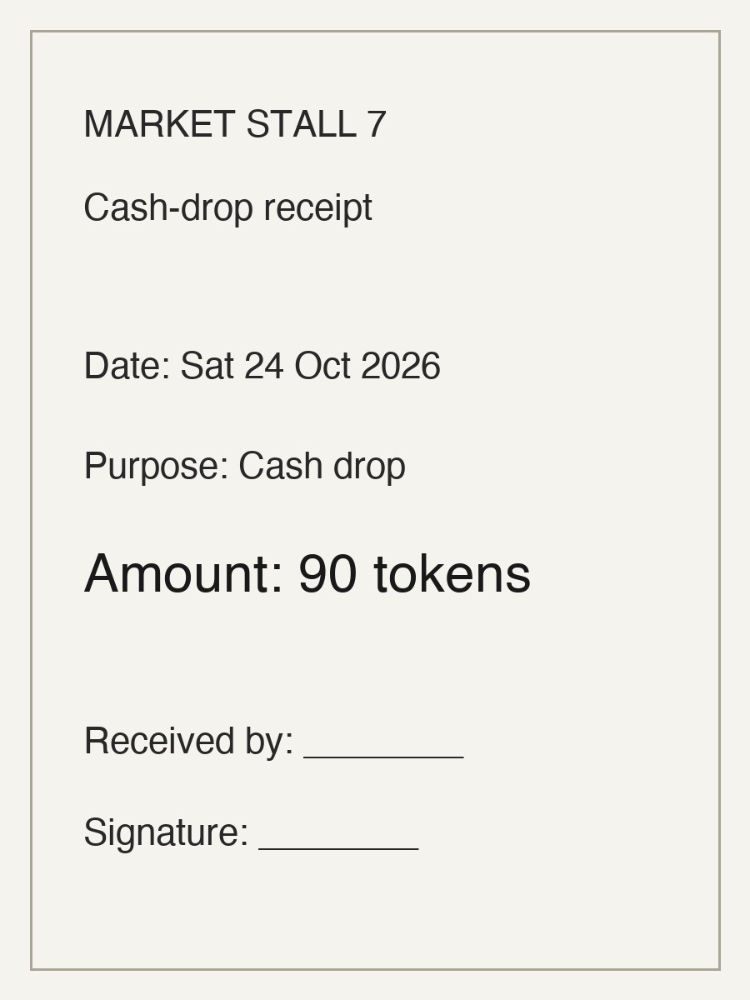

# Closeout — An AI financial investigator that refuses to turn guesses into financial facts

A trader finishes the day with a cash count that differs from the expected tally
and needs to understand why. Closeout investigates the gap: Meta's Muse asks
targeted clarification questions and reads receipt photos, while deterministic
code — never the model — evaluates the financial evidence. The discrepancy
stays unresolved until real evidence closes it.

## Why Closeout exists

An AI-generated explanation is not a financially supported conclusion. Most
tools blur that line: they reconcile silently or present a guess as an answer.
Closeout keeps the two apart. Muse provides advisory interpretation — what to
check next. Deterministic code does the arithmetic and decides what the
evidence can and cannot support. A matching receipt amount can explain a
difference mathematically without proving the money moved.

## How it works

1. Start with the synthetic closing discrepancy.
2. Muse generates one atomic investigative question (bounded to three turns).
3. The trader answers Yes, No, or Not sure.
4. The trader uploads a photo of a receipt while the investigation is open.
5. Muse extracts candidate document information, marked UNVERIFIED.
6. The trader confirms the transcription matches the photo, or corrects it.
7. Deterministic code compares the reviewed evidence against the discrepancy.
8. Closeout presents a conditional finding plus its unverified assumptions.

Confirmation means the transcription matches the photograph. It does not
authenticate the document or verify that any transaction occurred.

## Example investigation

- Tally: 510 tokens.
- Counted cash: 420 tokens.
- Difference: 90 tokens.
- Cash-drop receipt: 90 tokens.
- Conditional unexplained remainder: 0 tokens.



A mathematical match is not proof of cash removal. It shows the amounts would
reconcile *if* the cash drop occurred before counting and belongs to this
closing period — two facts the receipt alone cannot establish.

## Evidence safety

- Muse provides advisory interpretation only.
- All financial arithmetic is deterministic code.
- Original figures (420 counted, 510 tallied, 90 difference) are never changed.
- A reviewed transcription does not authenticate a receipt.
- Every finding lists its unverified assumptions.
- Financial status remains UNRESOLVED on every path.

## Technical architecture

- Python standard-library HTTP server (`server.py`, no dependencies).
- Vanilla HTML, JavaScript, and CSS (`web/`).
- Meta Model API with Muse Spark (`muse-spark-1.3`) for questions and image
  extraction; credentials stay server-side in `MODEL_API_KEY`
  (`MUSE_API_KEY` accepted as an alias).
- Bounded in-memory investigation state (three questions, then UNRESOLVED).
- Deterministic evidence comparison (`POST /api/evidence/compare`).
- Offline test suites and five synthetic scenarios.

## Quick start

Requires Python 3.9+ and a Meta Model API key. No packages to install.

```sh
git clone https://github.com/boscoj2008/meta-hackathon-closeout.git
cd meta-hackathon-closeout
export MODEL_API_KEY="your-key-here"  # never in code; MUSE_API_KEY also accepted
python3 server.py
```

Visit `http://127.0.0.1:8130/` in a browser. The source is public; the
application runs locally and is not hosted anywhere.

## Testing

These three suites run fully offline — no key, no network, no credits:

```sh
python3 experiments/hypothesis_selection/test_evaluation.py
python3 web/test_ui.py
python3 tests/test_server.py
```

Live operations consume Meta API credits: the experiment runner
(`python3 experiments/hypothesis_selection/run.py --all`, one call per
scenario) and, in the browser, Investigate with Muse (one call per question)
and Extract evidence (one call per photo).

## Demo walkthrough

1. Open the app and tap **Investigate with Muse**. Answer the question.
2. Before the third answer, tap **Add photo evidence** and choose
   `assets/synthetic-receipt.jpg`. Tap **Extract evidence**.
3. Confirm the transcription, then tap **Compare evidence**.
4. Result: potential full explanation, conditional remainder 0 tokens,
   financial status unresolved.

Other paths without new assets: correct the amount to 70 before comparing for
a partial explanation (remainder 20), or correct the date to another day for a
not-applicable finding.

## Limitations

- All figures, receipts, and scenarios are synthetic and invented for demo.
- Investigations are bounded at three questions and end UNRESOLVED.
- Receipts are never authenticated; reviewed text is a claim about the photo.
- Nothing here verifies a physical cash movement.
- Not production software: in-memory state, no accounts, no persistence.

Closeout suggests what to check. It never confirms financial facts without
evidence.
